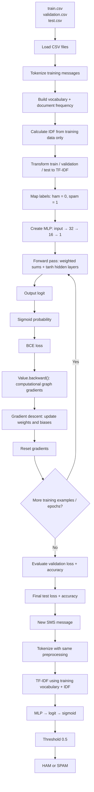

# SMS Spam Classifier — TF-IDF + Custom MLP

A from-scratch SMS spam classifier that connects **TF-IDF text features** to a manually implemented **Multi-Layer Perceptron (MLP)**.

A neural network performs a forward pass, computes loss, propagates gradients, and updates its parameters—without relying on a deep-learning framework or automatic differentiation.

## What this project does

1. Reads pre-split training, validation, and test CSV files.
2. Learns a vocabulary and inverse document frequency (IDF) values from the **training set only**.
3. Converts each SMS message into a TF-IDF vector.
4. Feeds each vector into a custom MLP.
5. Converts the output logit into a spam probability with sigmoid.
6. Computes Binary Cross-Entropy (BCE) loss.
7. Uses a custom computational graph to backpropagate gradients.
8. Updates weights and biases with gradient descent.
9. Evaluates on validation and test data.
10. Classifies new SMS messages using the training vocabulary and IDF values.

## Model architecture

The hidden layers use `tanh`. The final layer has no activation and returns a raw logit.

```text
TF-IDF feature vector
        |
        v
   Input layer
        |
        v
  Dense layer (32)
      tanh
        |
        v
  Dense layer (16)
      tanh
        |
        v
  Output layer (1)
      raw logit
        |
        v
     Sigmoid
        |
        v
 P(spam) in [0, 1]
        |
        v
 Threshold (0.5)
        |
        v
   HAM or SPAM
```

The input dimension is not hard-coded. It is the vocabulary size learned from the training data:

```python
input_size = X_train.shape[1]
model = MLP(
    number_of_inputs=input_size,
    layer_sizes=[32, 16, 1]
)
```

## Training flow

The training loop processes one example at a time (stochastic gradient descent):

1. Convert the TF-IDF vector to `Value` objects.
2. Run the MLP forward pass to produce a logit.
3. Apply sigmoid to get a probability.
4. Calculate BCE loss against the true label.
5. Call `loss.backward()` to calculate gradients.
6. Update each parameter: `parameter.data -= learning_rate * parameter.grad`.
7. Reset gradients to zero before the next example.

This process repeats for every training example and for each epoch.

## Custom automatic differentiation

The `Value` class is the core of the manual neural-network implementation. Each instance stores:

- `data`: the scalar's numeric value.
- `grad`: the gradient accumulated for that scalar.
- `_prev`: the values used to create it.
- `_op`: the operation that created it.
- `_backward`: a function that applies the local derivative.

Supported operations include addition, multiplication, negation, subtraction, power, division, exponential, logarithm, and `tanh`.

`backward()` builds a topological ordering of the computational graph, initializes the output gradient to `1.0`, and traverses the graph in reverse to propagate gradients.

## Repository files

```text
.
├── train_mlp.py
├── train.csv
├── validation.csv
├── test.csv
├── README.md
└── flowchart.mmd
```

The CSV files are input data expected by the script; they are not created by `train_mlp.py`.

## Requirements

- Python 3.9+
- NumPy
- pandas

Install the dependencies:

```bash
python -m pip install numpy pandas
```

## Dataset format

The script expects these files in the current working directory:

- `train.csv`
- `validation.csv`
- `test.csv`

Each CSV must contain the following columns:

| Column | Description | Expected values |
|---|---|---|
| `message` | SMS text | Text string |
| `label` | Ground-truth class | `ham` or `spam` |

Labels are mapped in the script as:

- `ham` → `0`
- `spam` → `1`

The train/validation/test split must already exist before running this script. The script does not create the split.

## Run

Place the three CSV files beside `train_mlp.py`, then run:

```bash
python train_mlp.py
```

The script uses these training settings:

| Setting | Value |
|---|---:|
| Hidden layer sizes | 32, 16 |
| Output units | 1 |
| Hidden activation | `tanh` |
| Output | Raw logit |
| Loss | Binary Cross-Entropy |
| Optimizer/update | Manual gradient descent |
| Epochs | 5 |
| Learning rate | 0.01 |
| Classification threshold | 0.5 |

## Making a prediction

At the end of the script, `classify_message()` accepts a new SMS string and returns its predicted class and spam probability.

```python
label, probability = classify_message(
    "Congratulations! You have won a free prize. Call now!"
)

print(label)
print(probability)
```

For a new message, the code reuses the training vocabulary and IDF values. Unknown words are ignored. It does **not** rebuild TF-IDF from the new message.

## Evaluation

After every epoch, the script prints:

- Training average BCE loss
- Validation average BCE loss
- Validation accuracy

After training, it reports test loss and test accuracy. The test set is used only for the final evaluation in this script.

Accuracy is useful but can be misleading when ham and spam counts are imbalanced. Precision, recall, F1-score, and a confusion matrix would provide a more complete evaluation; they are not currently implemented in this file.

## Important implementation notes

- **No PyTorch, TensorFlow, Keras, or sklearn neural-network estimator is used.**
- NumPy is used for numerical vectors and pandas for CSV loading.
- The vocabulary and IDF are fitted only on training messages to avoid validation/test information leaking into feature construction.
- Validation and test evaluation do not call `backward()` and do not update model parameters.
- Gradients are reset after each training example because the implementation accumulates gradients.
- The final MLP layer returns a logit; sigmoid is applied separately to obtain a probability.

## Scope and limitations

This is a learning implementation, not a production-ready spam filtering service.

- The script expects the CSV files and columns described above.
- The model is initialized randomly; no random seed is set, so runs may differ.
- Training is example-by-example and uses Python scalar objects, so it may be slow for large vocabularies or datasets.
- The script reports accuracy and BCE loss only.
- There is no model serialization or separate inference entry point in this file.

## Flow diagram

See [`flowchart.mmd`](flowchart.mmd) for the standalone Mermaid diagram. The same end-to-end flow is shown below.



## Learning takeaway

The central pipeline is:

**Text → TF-IDF → MLP → Logit → Sigmoid → Probability → BCE → Backpropagation → Gradient Descent**

The important idea is that the custom `Value` objects preserve the computational graph, allowing gradients to flow from the loss back to the MLP's weights and biases.
